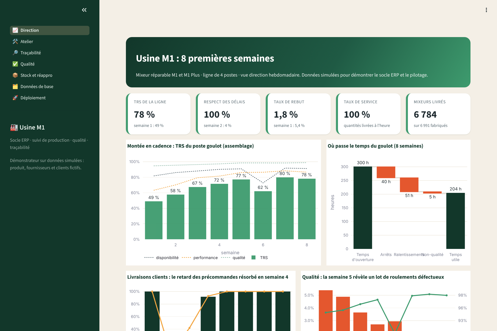
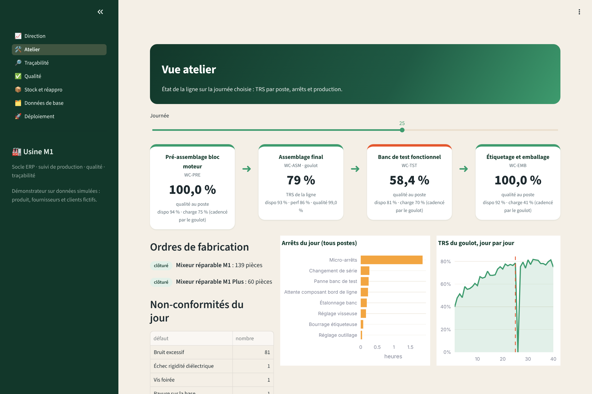
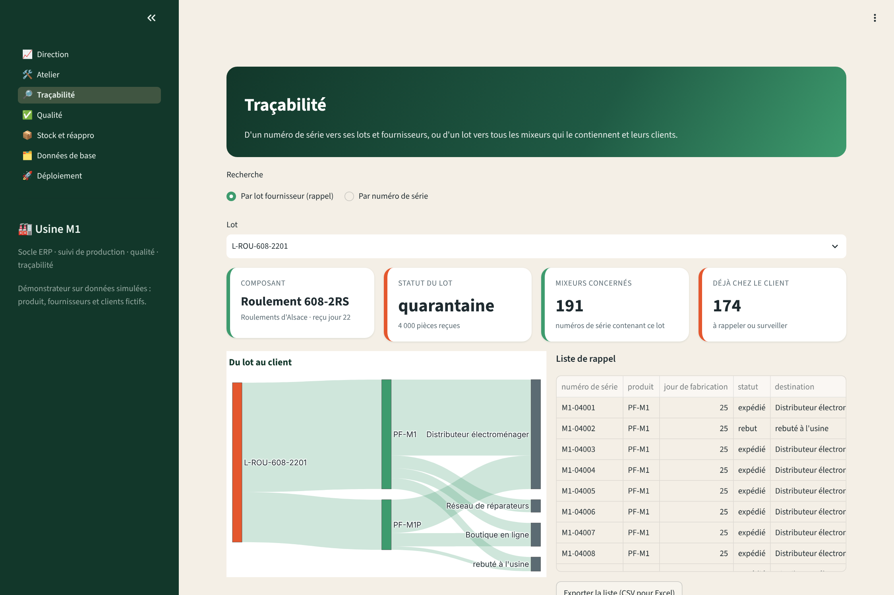
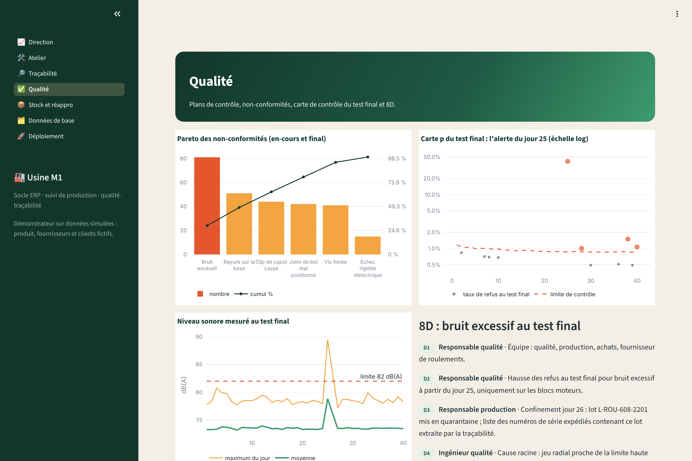
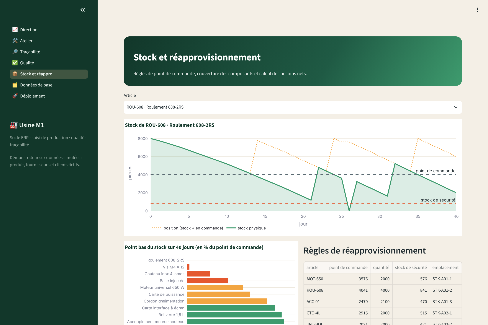
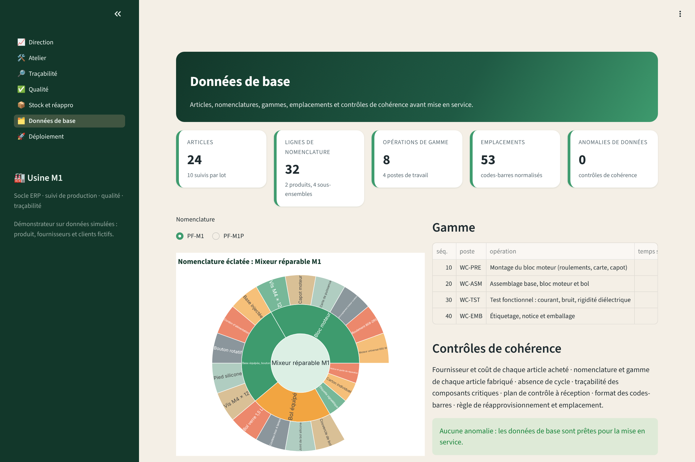
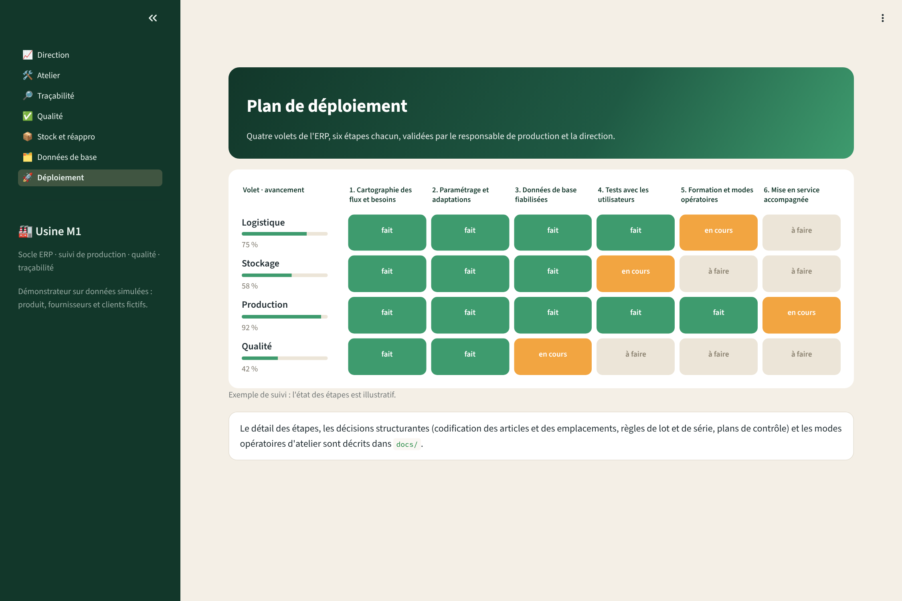
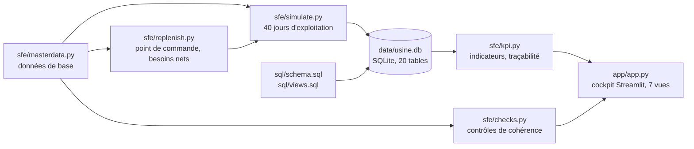

# Usine M1 : socle ERP, suivi de production et traçabilité d'une usine qui démarre

Démonstrateur du système d'information de base d'une jeune usine d'assemblage de petit électroménager réparable :
données de base propres, suivi d'atelier, contrôle qualité, traçabilité lot/série, réapprovisionnement et
indicateurs de pilotage, sur les **8 premières semaines de montée en cadence** d'une ligne de 4 postes.

> **Données simulées.** Le produit (mixeur réparable M1 et M1 Plus), les fournisseurs, les clients et tous les
> chiffres sont fictifs. Ils sont produits par une simulation reproductible (graine fixe), conçue pour faire
> apparaître les situations réelles d'un démarrage : montée en cadence, rupture fournisseur, lot défectueux,
> rappel ciblé.



## Ce que montre le projet

| Volet | Ce qui est en place |
|---|---|
| **Données de base** | 24 articles, nomenclatures multiniveaux, gammes, 53 emplacements codifiés, plans de contrôle, règles de réappro. 18 règles de cohérence bloquent la mise en service si une donnée est fausse. |
| **Production** | Ordres de fabrication, saisies atelier par poste (temps d'ouverture, arrêts, bons, rebuts), TRS du poste goulot, Pareto des arrêts. |
| **Qualité** | Contrôle à réception, en-cours et final ; non-conformités ; carte p du test final ; 8D complet sur un incident. |
| **Traçabilité** | Généalogie série → lots de composants (65 000 liens). Un lot suspect donne en une requête la liste des appareils concernés et des clients livrés. |
| **Stock et réappro** | Mouvements de stock, point de commande et stock de sécurité calculés, position (stock + en commande), besoins nets. |
| **Pilotage** | Vue direction hebdomadaire : TRS, respect des délais, taux de rebut, taux de service. |
| **Déploiement** | Plan en 6 étapes par volet, modes opératoires d'atelier, décisions structurantes documentées. |

## L'histoire racontée par les données

1. **Semaines 1 à 3 : démarrage.** Le TRS du goulot passe de 49 % à 67 %. Les précommandes de lancement sont livrées en retard : le respect des délais tombe à 4 % en semaine 2.
2. **Jour 18 : lot de cartes de puissance refusé au contrôle à réception.** Il part en quarantaine ; le lot de remplacement arrive le jour 21, sans arrêt de ligne.
3. **Jour 25 : la carte p du test final sort de ses limites** (bruit excessif). Le 8D est ouvert ; le lot de roulements L-ROU-608-2201 (reçu le jour 22) est confiné le jour 26 ; la ligne s'arrête une journée faute de roulements conformes (TRS de la semaine 6 : 62 %).
4. **Traçabilité :** le lot touche 191 numéros de série, dont 174 déjà expédiés (les 17 autres ont été rebutés à l'usine). La liste des clients à rappeler sort en une requête.
5. **Semaine 8 :** TRS 78 %, 100 % des commandes à l'heure, taux de rebut ramené de 5,4 % à 1,8 %.

| Atelier | Traçabilité |
|---|---|
|  |  |
| **Qualité** | **Stock et réappro** |
|  |  |
| **Données de base** | **Déploiement** |
|  |  |

## Lancer le projet

```bash
pip install -r requirements.txt
python -m sfe.db                 # construit data/usine.db (schéma, simulation, vues)
streamlit run app/app.py         # cockpit sur http://localhost:8501
python -m pytest                 # 30 tests : données, base simulée, indicateurs, pages du cockpit
```

## Architecture



- **Une seule source de vérité :** les indicateurs sont des vues SQL (`v_trs_poste_jour`, `v_service_jour`, `v_qualite_jour`, `v_stock_jour`, `v_tracabilite`). L'atelier et la direction lisent les mêmes chiffres.
- **Modèle de données :** 8 tables de données de base et 12 tables de flux (achats, réceptions, contrôles, mouvements de stock, commandes clients, OF, saisies atelier, arrêts, numéros de série, généalogie, non-conformités, actions correctives). Détail dans [docs/dictionnaire_donnees.md](docs/dictionnaire_donnees.md).
- **Reproductible :** même graine, mêmes données ; la base se reconstruit en quelques secondes.

## Documentation

- [Cartographie des flux](docs/cartographie_flux.md) : flux physiques et flux d'information, de la commande fournisseur à l'expédition.
- [Modes opératoires d'atelier](docs/modes_operatoires.md) : réception, saisie de production, contrôle final, rappel de lot.
- [Plan de déploiement et décisions](docs/deploiement.md) : étapes par volet, choix de codification, règles de lot et de série.
- [Dictionnaire de données](docs/dictionnaire_donnees.md).

## Choix et limites

- SQLite et Streamlit pour un démonstrateur autonome. Dans une usine réelle, ce socle se paramètre dans l'ERP retenu (Odoo, par exemple) ; la valeur est dans le modèle de données, les règles et la méthode de déploiement, pas dans l'outil.
- Le TRS de la ligne est celui du poste goulot (assemblage final). Les autres postes sont suivis en charge et en qualité.
- Le réapprovisionnement utilise un point de commande avec stock de sécurité (niveau de service visé 95 %). Le calcul des besoins nets est un MRP simplifié sur un horizon donné.

## Licence

MIT, voir [LICENSE](LICENSE).
