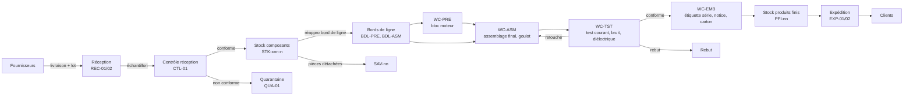
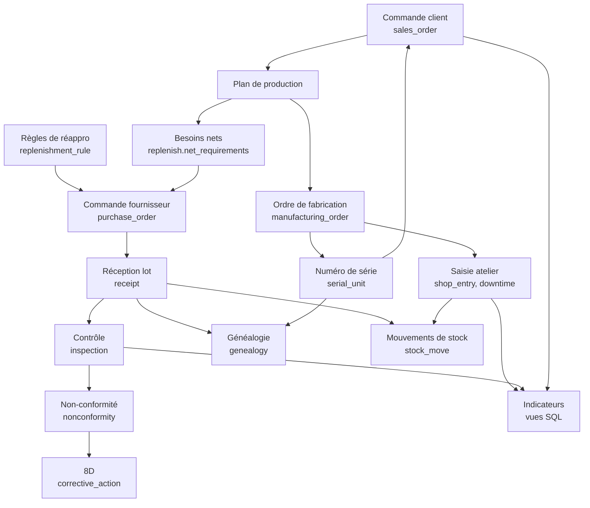

# Cartographie des flux

Première étape du déploiement : décrire ce qui circule réellement dans l'usine avant de paramétrer quoi que ce soit.
Chaque flèche correspond à une transaction enregistrée dans le socle.

## Flux physique

## Flux d'information

## Points de saisie

| Où | Qui | Quoi | Table |
|---|---|---|---|
| Quai de réception | Magasinier | Scan de l'étiquette fournisseur, création du lot, emplacement de dépose | `receipt`, `stock_move` |
| Contrôle réception | Contrôleur | Mesures sur l'échantillon défini par le plan de contrôle | `inspection` |
| Chaque poste | Opérateur | Début et fin d'OF, quantités bonnes et rebutées, arrêts avec cause | `shop_entry`, `downtime` |
| Pré-assemblage | Opérateur | Scan des lots de composants critiques montés | `genealogy` |
| Banc de test | Automatique | Courant, bruit, rigidité diélectrique par numéro de série | `inspection` |
| Emballage | Opérateur | Impression de l'étiquette série | `serial_unit` |
| Expédition | Magasinier | Scan des numéros de série par commande | `sales_order`, `serial_unit` |
